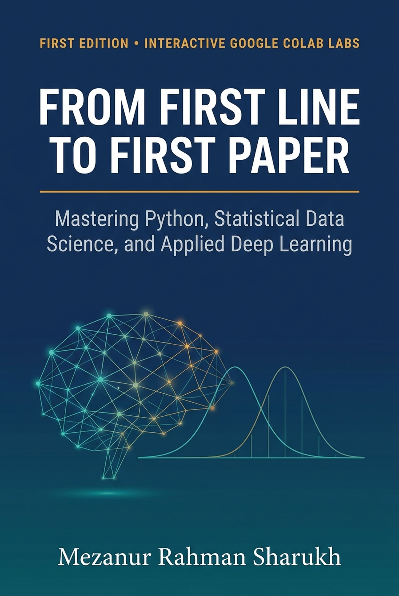

# Preface {.unnumbered}

::: {.content-visible when-format="html"}
```{=html}
<div class="book-hero">
  <div class="book-hero-grid">
    <div>
      <div class="book-hero-meta">First edition, 2026 · 36 ch. + 5 app. · DOI&nbsp;10.5281/zenodo.24446563</div>
      <h1 class="book-hero-title">From First Line to First Paper</h1>
      <p class="book-hero-subtitle">Mastering Python, Statistical Data Science, and Applied Deep Learning</p>
      <p class="book-hero-byline">An open-access textbook and interactive Google Colab curriculum by <a href="https://sharukh01621.github.io/">Mezanur Rahman Sharukh</a> — written from absolute zero to reproducible statistical modelling, PyTorch architectures, fairness audits, and publication-ready research.</p>

      <div class="book-hero-figures">
        <div>
          <span class="book-figure-val">860</span>
          <span class="book-figure-label">Book pages</span>
        </div>
        <div>
          <span class="book-figure-val">182</span>
          <span class="book-figure-label">Colab labs</span>
        </div>
        <div>
          <span class="book-figure-val">324</span>
          <span class="book-figure-label">Auto checks</span>
        </div>
        <div>
          <span class="book-figure-val">972</span>
          <span class="book-figure-label">Guided hints</span>
        </div>
      </div>

      <div class="book-cmd-bar">
        <code>pip install sharukh-tutor</code>
        <button id="book-copy-pip" class="book-btn-micro" type="button">Copy</button>
      </div>

      <div class="book-hero-actions">
        <a href="part_01_python_foundations/ch01_first_program.html" class="book-btn book-btn-primary">Start Chapter 1</a>
        <a href="https://github.com/sharukh01621/first-line-to-first-paper/releases/download/v1.0.2/From-First-Line-to-First-Paper.pdf" class="book-btn book-btn-secondary" target="_blank" rel="noopener">Download PDF (12.5 MB)</a>
      </div>

      <div class="book-hero-links">
        <a href="https://github.com/sharukh01621/first-line-to-first-paper/releases/download/v1.0.2/From-First-Line-to-First-Paper.epub" target="_blank" rel="noopener">EPUB 3</a>
        <a href="https://colab.research.google.com/github/sharukh01621/first-line-to-first-paper/blob/main/colab_drive/00_START_HERE.ipynb" target="_blank" rel="noopener">Colab hub</a>
        <a href="https://drive.google.com/drive/folders/1pHBCVND-bRsPV4FarRPqOmivYkVmRFBF?usp=drive_link" target="_blank" rel="noopener">Google Drive</a>
        <a href="https://pypi.org/project/sharukh-tutor/" target="_blank" rel="noopener">PyPI</a>
        <a href="https://github.com/sharukh01621/first-line-to-first-paper" target="_blank" rel="noopener">GitHub</a>
      </div>
    </div>

    <a href="part_01_python_foundations/ch01_first_program.html" class="book-hero-cover-wrap">
      
    </a>
  </div>
</div>
```
:::

::: {.content-visible unless-format="html"}
*From First Line to First Paper: Mastering Python, Statistical Data Science, and Applied Deep Learning* is a complete, zero-to-researcher open-access textbook and interactive Google Colab curriculum authored by **Mezanur Rahman Sharukh** (Statistician, Public Health and Machine Learning Researcher).
:::

## Who this book is written for

This book makes no assumptions about prior programming experience. Whether you are a public health student opening a coding environment for the first time, a biostatistician moving from SPSS or Stata to Python, or a quantitative researcher who wants to understand every equation and line of code from first principles, each chapter builds step by step without skipping a link in the chain.

By the end of Part VII, you will move beyond Python syntax to work like a disciplined research software engineer and applied machine learning scientist — taking raw epidemiological or clinical datasets through survey cleaning, leakage-free pipelines, PyTorch architectures, systematic ablation studies, subgroup fairness audits, and reproducible research releases.

---

## How the dual-synced book and Google Colab ecosystem works

Every chapter in this book is paired 1-to-1 with interactive Google Colab notebooks stored across two mirrored hubs:

- **GitHub repository (live Colab links):** [github.com/sharukh01621/first-line-to-first-paper](https://github.com/sharukh01621/first-line-to-first-paper)
- **Google Drive mirror (full curriculum and datasets):** [Open shared Google Drive folder](https://drive.google.com/drive/folders/1pHBCVND-bRsPV4FarRPqOmivYkVmRFBF?usp=drive_link)

1. **Walkthrough notebook (`01_walkthrough.ipynb`):** Every code snippet and "Break It On Purpose" error lab printed in the chapter verbatim.
2. **Guided to-do notebook (`02_guided_todos.ipynb`):** Hands-on exercises with `# YOUR CODE HERE` slots, 3-tier progressive hints (`tutor.hint(..., level=1..3)`), and diagnostic checks (`tutor.check(...)`) powered by the open-source PyPI package `sharukh-tutor` (`pip install sharukh-tutor`).
3. **Chapter coding exam (`03_coding_exam.ipynb`):** A 100-point chapter assessment graded automatically with `tutor.check_exam(...)`.
4. **Annotated solution notebooks (`solutions/.../*_SOLUTION.ipynb`):** Complete worked solutions paired with debugging post-mortems explaining common mistakes and how to avoid them.

### Quick-start onboarding hub {.unnumbered}

| Onboarding lab | Interactive Google Colab launch link | Scan (print) |
| :--- | :--- | :---: |
| **Curriculum index** | [00_START_HERE.ipynb](https://colab.research.google.com/github/sharukh01621/first-line-to-first-paper/blob/main/colab_drive/00_START_HERE.ipynb) | {width=58px} |
| **2-minute setup** | [00_setup / 00_colab_orientation.ipynb](https://colab.research.google.com/github/sharukh01621/first-line-to-first-paper/blob/main/colab_drive/00_setup/00_colab_orientation.ipynb) | {width=58px} |

: {tbl-colwidths="[22,56,22]"}

::: {.callout-tip title="First-time setup (2 minutes)"}
Before starting Chapter 1, open the **Colab Orientation Notebook** (`00_setup/00_colab_orientation.ipynb`), select **File $\rightarrow$ Save a copy in Drive**, and run its three welcome cells to verify your runtime and preview the bundled public health spine datasets.
:::

---

## The researcher's 4-step problem-structuring blueprint

Beginners often freeze at a blank code cell because they try to write Python syntax before designing the logic. Across all 36 chapters, before writing code for any non-trivial problem, we complete four steps:

1. **Inputs and units:** What exact values enter the problem, what data types are they, and what units (kg, cm, mmHg, per 100,000) do they carry?
2. **Edge cases and traps:** What could silently go wrong — zero denominators, missing survey sentinel codes such as `999`, operator precedence mistakes, floating-point truncation, or data leakage?
3. **Step-by-step algorithm:** Plain-English ordered steps written before Python.
4. **Verification plan:** Hand-calculated or domain-bounded sanity checks proving the output makes scientific sense.

---

## Visual callout legend

- **Mental Model (`Note`):** Diagrams and analogies showing what happens inside Python's memory and interpreter.
- **Researcher's Note (`Tip`):** Statistical, epidemiological, and reproducible-science best practices.
- **Common Trap (`Warning`):** Subtle bugs that run without crashing and silently corrupt analyses.
- **Break It On Purpose (`Important`):** Controlled experiments that trigger real Python errors so you learn to read tracebacks calmly.

---

## Master 7-part curriculum roadmap (First edition, 860 pages)

| Part | Chapters | Core mastery milestone | Pages |
| :--- | :---: | :--- | :---: |
| **Part I** | Ch 1–6 | Computational thinking and Python from absolute zero | 110 |
| **Part II** | Ch 7–11 | Core data structures, algorithms, and defensive programming | 105 |
| **Part III** | Ch 12–15 | OOP, Jupyter/Colab engineering, VS Code, and Git | 90 |
| **Part IV** | Ch 16–20 | NumPy, Pandas, survey cleaning, visualization, and biostatistics | 115 |
| **Part V** | Ch 21–26 | Classical machine learning from scratch math to leakage-free pipelines | 140 |
| **Part VI** | Ch 27–32 | Deep learning from NumPy backprop to PyTorch, CNNs, and Transformers | 145 |
| **Part VII** | Ch 33–36 | Rigorous experiments, ablation studies, fairness, and capstone paper | 115 |
| **Appendices** | A–E | Cheat sheets, math refresher, Top-50 error decoder, Colab index, and references | 50 |

: {tbl-colwidths="[16,14,56,14]"}
